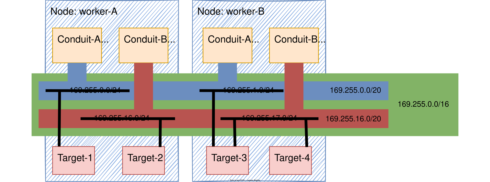

# IPAM

* [cmd](https://github.com/Nordix/Meridio/tree/master/cmd/ipam)
* [Dockerfile](https://github.com/Nordix/Meridio/tree/master/build/ipam)

## Description

In order to avoid IP collisions in the system and ensure a proper IPs distribution, this service is offering some IPAM functionalities that can be consumed using a kubernetes clusterIP service (over the kubernetes primary network). This IPAM Service is a [GRPC](https://grpc.io/) server listening on port 7777.

The specifications of the IPAM Service are written in a proto file accessible [here](https://github.com/Nordix/Meridio/blob/master/api/ipam/v1/ipam.proto).

### IP/Prefix distribution granularity

The Meridio IPAM distributes IP/Prefixes (always within the trench subnet defined in the configuration by `IPAM_PREFIX_IPV4` and `IPAM_PREFIX_IPV6`) at a few different levels. 

The first one is at the conduit level. Represented in blue (Conduit-A) and in red (Conduit-B) in the picture below, they are allocated automatically by the IPAM by watching the conduit list via the NSP service. The conduit subnet prefix lengths are defined in the configuration by `IPAM_CONDUIT_PREFIX_LENGTH_IPV4` and `IPAM_CONDUIT_PREFIX_LENGTH_IPV6`.

The second one is at the node level. Represented in black in the picture below (1 per node per conduit), they are allocated when the `Allocate` API function is called (note: implicitly unallocated if the conduit is removed.). The node subnet prefix lengths are defined in the configuration by `IPAM_NODE_PREFIX_LENGTH_IPV4` and `IPAM_NODE_PREFIX_LENGTH_IPV6`.

The third (last one) is at the pod level. Each pod will get assigned a unique IP address with `IPAM_NODE_PREFIX_LENGTH_IPV4` or `IPAM_NODE_PREFIX_LENGTH_IPV6` as prefix length.



Picture representing a cluster with 2 nodes (worked-A and worker-B), 2 conduits (Conduit-A and Conduit-B), 4 targets and the corresponding subnets.
* Target-1 is running on worker-A and connected to Conduit-A
* Target-2 is running on worker-A and connected to Conduit-B
* Target-3 is running on worker-B and connected to Conduit-A and Conduit-B
* Target-4 is running on worker-B and connected to Conduit-B

### Data persistence

Running as StatefulSet with a single replica, the IPAM handles restarts and pod deletions by saving the data in a local sqlite stored in a persistent volume requested via a volumeClaimTemplates.

### Garbage Collector

Pod-level prefixes might remain in the database without an owner. Moreover, currently there's no explicit way to unallocate a node-level prefix.  
To prevent premature exhaustion of the associated prefix pools, a Garbage Collector (GC) mechanism was implemented. When enabled, this mechanism periodically checks the last update time of prefixes associated with pods or nodes. (Such prefixes would have their 'updatedAt' timestamp refreshed on `Allocate` or `Release` API function calls.)  
Based on a configurable threshold, records can be deemed stale and removed by the GC. For node-level prefixes, the descendant prefixes are also reclaimed.

### Storage statistics

For diagnosing storage latency and lock contention, the IPAM can log statistics of its storage. They are disabled by default. `IPAM_STORAGE_STATS_ENABLED` enables them at start, and `SIGWINCH` toggles them at runtime:

```bash
kubectl exec -n <namespace> <ipam-pod> -c ipam -- kill -WINCH 1
```

The IPAM logs `Storage statistics enabled` or `Storage statistics disabled` on each toggle. While enabled, it logs a `Storage statistics` report every `IPAM_STORAGE_STATS_INTERVAL`, when disabled, and on shutdown. Statistics stay enabled until toggled off, and each enable starts from zero.

#### Background

All access to the sqlite database is serialized by a single storage lock. Every storage operation (`Get`, `GetChilds`, `Add`, `Update`, `Delete`) takes the lock once, and so do garbage collector runs. Waiting callers are served in FIFO order. A caller whose request context ends while waiting gives up without getting the lock.

The statistics measure two things:
* Storage operations, counted as reads (`Get`, `GetChilds`) and writes (`Add`, `Update`, `Delete`). The latency of an operation is measured around the whole call, so it includes the time spent waiting for the lock.
* The storage lock itself: how often it was acquired, how often a caller had to wait for it, and for how long.

Durations are printed in Go duration format, for example `19m46.262803s` or `194.591ms`.

#### Report fields

A report has a single `stats` field:

Field | Description
--- | ---
`trigger` | Why the report was logged: `interval`, `disable` (toggled off with `SIGWINCH`) or `shutdown`
`enabledFor` | Time since statistics were enabled. All `total` counters cover this period
`sinceLast` | Time since the previous report, or since enable for the first report. All `delta` counters and `peak` values cover this period. It is shorter than `IPAM_STORAGE_STATS_INTERVAL` when the report was triggered by `disable` or `shutdown`
`lockWaiters` | Number of callers waiting for the lock at the moment the report was taken
`total` | Counters since enable (see below)
`delta` | The same counters, since the previous report
`peak` | Maximums since the previous report (see below). They are not maximums over the whole enabled period

`total` and `delta` each contain `read`, `write` and `lock`.

`read` and `write`:

Field | Description
--- | ---
`count` | Number of completed operations. Equal to the sum of the outcome counters below
`ok` | Operations that succeeded
`ctxErr` | Operations that failed because the request context was cancelled or its deadline expired, for example while waiting for the lock
`cidrConflict` | `Add` calls rejected because the prefix overlaps an existing one. These are retried by the allocator, so a few are expected under concurrent allocation
`idConflict` | `Add` calls rejected because a prefix with the same primary ID already exists. The allocator then returns the existing prefix, so this is not a failure for the caller
`otherErr` | Operations that failed for any other reason
`time` | Sum of the latencies of all operations, lock wait included. This is not elapsed time: operations that run or wait concurrently each add their full latency, so `time` can be larger than `enabledFor`
`buckets` | Number of operations per latency range: `[<1ms, 1ms-10ms, 10ms-100ms, 100ms-1s, >=1s]`. The values add up to `count`

`lock`:

Field | Description
--- | ---
`acquired` | Number of times the lock was acquired, with or without waiting. Includes garbage collector runs, so it can be slightly higher than `read.count + write.count`
`contended` | Acquisitions where the lock was busy (or others were already queued) and the caller had to wait. A subset of `acquired`
`abandoned` | Lock attempts that gave up because the request context was done, either on entry or while waiting. Not part of `acquired`
`wait` | Sum of the time callers spent waiting for the lock, over all `contended` and `abandoned` attempts. Uncontended acquisitions add nothing. Like `time`, concurrent waits each add their full duration

`peak`:

Field | Description
--- | ---
`read`, `write` | Longest single read or write, lock wait included
`lockWait` | Longest single wait for the lock
`lockWaiters` | Highest number of callers waiting for the lock at the same time

Counters are read one by one without stopping the IPAM, so a report taken under load can be off by an operation or two.

#### Interpreting the report

The raw sums are mostly useful through a few derived values, computed from either `total` or `delta`:

Value | Formula | Meaning
--- | --- | ---
Mean read/write latency | `time / count` | Average latency seen by callers, lock wait included
Contention ratio | `lock.contended / lock.acquired` | Share of acquisitions that had to queue
Mean wait when contended | `lock.wait / lock.contended` | How long a caller typically queues once it has to
Share of latency spent waiting | `lock.wait / (read.time + write.time)` | How much of the operation latency is queueing rather than database work
Database work | `read.time + write.time - lock.wait` | Approximate time the lock was held for reads and writes (garbage collector runs are not included)
Lock utilization | database work `/ enabledFor` (or `/ sinceLast`) | Approximate share of time the lock was held

How to read the results:
* If most of the latency is lock wait while the lock utilization is low, requests arrive in bursts. The database itself is fast, but callers queue behind each other during the bursts. `peak.lockWaiters` shows how deep the queue gets.
* If the database work per operation is high, the sqlite operations themselves are slow (for example, slow storage or CPU throttling of the IPAM container).
* Mean latencies hide the tail. Check the last `buckets` entries: operations of 100ms or more are the ones likely to cause slow allocations.
* `ctxErr` and `lock.abandoned` mean that callers ran out of time. They point to client-side timeouts being hit, typically because of long lock waits.
* Use `delta` to follow a load test interval by interval, and `total` for the overall picture.

Example: a `total` section with `read.count` 110074, `read.time` 19m46s, `write.count` 69970, `write.time` 18m0s, `lock.acquired` 180045, `lock.contended` 80701 and `lock.wait` 34m24s, over an `enabledFor` of 1h57m:
* Mean latency is about 10.8ms per read and 15.4ms per write.
* 45% of the acquisitions had to wait, about 25.6ms on average.
* Lock wait is about 91% of the operation latency (34m24s of 37m46s). The remaining database work is about 3m22s, around 1.1ms per operation, so the lock was held only about 3% of the time.
* Conclusion: the database work is cheap, and the latency comes from bursts of concurrent requests queueing for the lock.

## Configuration 

https://github.com/Nordix/Meridio/blob/master/cmd/ipam/config.go

Environment variable | Type | Description | Default
--- | --- | --- | ---
IPAM_PORT | int | Port the pod is running the service | 7777
IPAM_DATA_SOURCE | string | Path and file name of the sqlite database | /run/ipam/data/registry.db
IPAM_TRENCH_NAME | string | Trench the pod is running on | 
IPAM_NSP_SERVICE | string | IP (or domain) and port of the NSP Service | 
IPAM_PREFIX_IPV4 | string | IPv4 prefix from which the proxy prefixes will be allocated | 169.255.0.0/16
IPAM_CONDUIT_PREFIX_LENGTH_IPV4 | int | Conduit prefix length which will be allocated | 20
IPAM_NODE_PREFIX_LENGTH_IPV4 | int | node prefix length which will be allocated | 24
IPAM_PREFIX_IPV6 | string | IPv6 prefix from which the proxy prefixes will be allocated | fd00::/48
IPAM_CONDUIT_PREFIX_LENGTH_IPV6 | int | Conduit prefix length which will be allocated | 56
IPAM_NODE_PREFIX_LENGTH_IPV6 | int | node prefix length which will be allocated | 64
IPAM_IP_FAMILY | string | IP family (ipv4, ipv6, dualstack) | dualstack
IPAM_LOG_LEVEL | string | Log level (TRACE, DEBUG, INFO, WARNING, ERROR, FATAL, PANIC) | DEBUG
IPAM_GRPC_KEEPALIVE_TIME | time.Duration | gRPC keepalive timeout | 30s
IPAM_GRPC_PROBE_RPC_TIMEOUT | time.Duration | RPC timeout of internal gRPC health probe | 1s
IPAM_GRPC_KEEPALIVE_MIN_TIME | time.Duration | Minimum interval between client keepalive pings accepted by the gRPC server | 15s
IPAM_GRPC_MAX_BACKOFF | time.Duration | Upper bound on gRPC connection backoff delay | 5s
IPAM_GARBAGE_COLLECTION_ENABLED | bool | IP garbage collection enabled or disabled | true
IPAM_GARBAGE_COLLECTION_INTERVAL | time.Duration | Interval at which IP garbage collection is running | 2h
IPAM_GARBAGE_COLLECTION_THRESHOLD | time.Duration | IP record older than threshold is considered leftover | 40m
IPAM_STORAGE_STATS_ENABLED | bool | Storage statistics enabled at start (toggled at runtime by SIGWINCH) | false
IPAM_STORAGE_STATS_INTERVAL | time.Duration | Interval at which storage statistics are logged while enabled | 30s

## Command Line 

Command | Action | Default
--- | --- | ---
--help | Display a help describing |
--version | Display the version |
--debug | Prints meridio-version, unix-time, network-interfaces, rules, route, neighbors, system information, and environment-variables in a json format |

## Signals

Signal | Action
--- | ---
SIGUSR1 | Set the log level to `IPAM_LOG_LEVEL`
SIGUSR2 | Set the log level to TRACE
SIGWINCH | Toggle the [storage statistics](#storage-statistics)
SIGTERM, SIGINT, SIGHUP, SIGQUIT | Shut down

## Communication 

Here are all components the ipam is communicating with:

Component | Secured | Method | Description
--- | --- | --- | ---
Spire | TBD | Unix Socket | Obtain and validate SVIDs
NSP Service | yes (mTLS) | TCP | Watch configuration

An overview of the communications between all components is available [here](resources.md).

## Health check

The health check is provided by the [GRPC Health Checking Protocol](https://github.com/grpc/grpc/blob/master/doc/health-checking.md). The status returned can be `UNKNOWN`, `SERVING`, `NOT_SERVING` or `SERVICE_UNKNOWN`.

Service | Description
--- | ---
Liveness | A unique service to be used by liveness probe to return status, can aggregate other lesser services
Readiness | A unique service to be used by readiness probe to return status, can aggregate other lesser services
Startup | A unique service to be used by startup probe to return status, can aggregate other lesser services

Service | Probe | Description
--- | --- | ---
IPAM | Liveness | Monitor status of the server

## Privileges

No privileges required.
